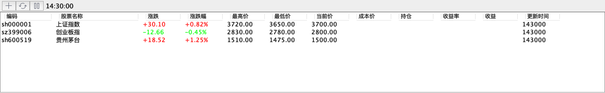
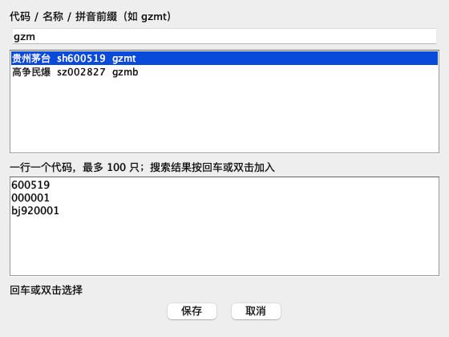
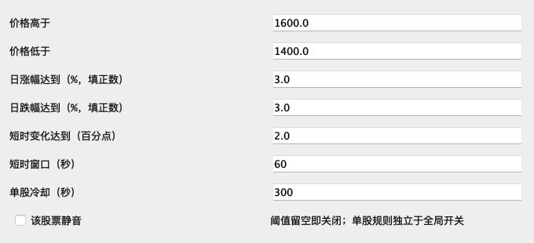
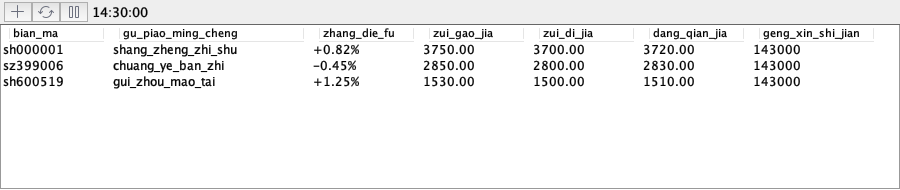

# sMate

Intelij IDEA 中的股票行情小助手。批量管理自选、用拼音搜索股票、设置单股提醒，在多个项目窗口查看同一份行情。

## 界面预览

以下截图由当前 Swing 组件渲染，使用示例数据。主题、字体和布局会随 IDE 设置变化。



## 安装与打开

当前插件面向 IntelliJ IDEA 2026.1 及以上平台版本，最低平台构建号为 `261`。

1. 下载仓库中的 [sMate 安装包](distribution/sMate-1.0-SNAPSHOT.zip)，或使用本地构建的 `build/distributions/sMate-1.0-SNAPSHOT.zip`。
2. 打开 IDE 的 **Settings → Plugins**。
3. 点击齿轮菜单，选择 **Install Plugin from Disk…**，选中 ZIP 文件。
4. 按 IDE 提示重启，在底部工具窗口打开 **sMate**。

在设置中搜索 **sMate**，可以修改刷新间隔、行情源、隐蔽模式和代理。

## 添加自选股

点击工具栏 **＋**，在多行输入区粘贴股票代码，一行一个。例如：

```text
600519
000001
bj920001
hk00700
usAAPL
```

点击 **保存** 后，sMate 使用当前行情源统一校验新增股票。全部通过后一次保存，并立即刷新所有窗口。

- 一次最多输入 100 只股票，支持空行和 Windows 换行符。
- 六位代码自动识别沪深北市场，已有自选和本次输入中的重复项会合并。
- 原有自选顺序保持不变，新股票按输入顺序追加。
- 格式错误会提示行号，缺少行情会列出对应代码。失败时保留输入，方便修改后重新保存。

指数建议显式填写市场前缀。例如，`sh000001` 表示上证指数，直接输入 `000001` 会识别为 `sz000001`。

右键某一行可编辑代码或删除自选。编辑时只接收一个代码。

## 高级功能

### 用拼音前缀搜索

添加和编辑窗口的搜索框支持股票代码、中文名称和拼音前缀。例如输入 `gzm` 或 `gzmt` 搜索贵州茅台。



停止输入约 300 毫秒后开始查询，结果显示名称、代码和拼音缩写。

1. 按向下键进入结果列表，用上下键切换股票。
2. 按 **Enter** 或双击结果，将代码加入下方输入区。
3. 继续搜索其他股票，最后统一保存。

编辑单只股票时，选择结果会替换输入区的代码。按 **Esc** 可关闭窗口。

### 设置单股提醒

右键股票，选择 **设置提醒规则**。各项阈值可单独启用，留空表示关闭。



| 规则 | 填写方式 |
| --- | --- |
| 价格高于或低于 | 填写目标价格 |
| 日涨幅达到 | 填写正数，例如 `3` 表示上涨至少 3% |
| 日跌幅达到 | 填写正数，例如 `3` 表示下跌至少 3% |
| 短时变化达到 | 填写涨跌幅变化的绝对值，单位为百分点 |
| 短时窗口 | 默认 `60` 秒，可设为 1 至 3600 秒 |
| 单股冷却 | 默认 `300` 秒，可设为 0 至 86400 秒 |

例如，短时变化设为 `2`、窗口设为 `60`，表示 60 秒窗口内涨跌幅变化达到 2 个百分点时提醒。涨跌幅从 `1%` 变为 `3%`，变化就是 2 个百分点。

同一条件持续满足时不会每次刷新都重复提醒。条件解除后可以重新触发，并受单股冷却时间限制。右键 **切换单股静音** 或勾选规则中的 **该股票静音**，可暂停该股票的提醒。

单股规则独立于设置中的全局 **预警** 开关。未设置单股规则的股票，开启全局预警后使用默认异动规则：60 秒内涨跌幅变化达到 2 个百分点。

提醒在 IDE 运行且行情刷新启用时检查，只处理与当前时间相差不超过 60 秒的新行情。刷新间隔过长、行情延迟或暂停刷新都会影响触发时机。

### 在多个项目中共享行情

同一个 IDE 实例打开多个项目时，每个项目都有独立的表格、排序和状态控件，共享自选配置与行情数据。

- 多个窗口只运行一份刷新任务，新增窗口直接接收当前行情。
- 行情刷新、股票搜索和输入校验使用同一个串行请求队列。
- 提醒按新行情统一计算，窗口数量不会增加提醒次数。
- 在任意窗口暂停或恢复刷新，会同步影响其他窗口。
- 关闭一个项目不影响其余窗口。关闭最后一个已打开 sMate 的项目后停止定时刷新，再次打开时恢复。

### 使用隐蔽显示

在 **Settings → sMate** 勾选 **超隐蔽模式**，表头和股票名称转为拼音。普通和隐蔽模式都使用主题默认文字颜色，保留编码、股票名称、涨跌幅、最高价、最低价、当前价和更新时间七列。



工具栏只显示 `HH:mm:ss` 格式的行情时间，取当前列表中最早的行情时间。该时间来自行情数据，不是请求完成时间；休市或刷新失败时可能保持不变。

### 查看分时与 K 线

双击股票打开分时图。右键菜单可选择分时、日 K、周 K 或月 K 图。

图表使用独立的图片数据源，支持沪深、港股和美股对应图表。当前北交所代码未接入图表。

## 配置刷新与行情源

在设置中搜索 **sMate**，修改 **持续刷新 Cron 表达式**。默认每 10 秒刷新一次。

| 刷新频率 | Cron 表达式 |
| --- | --- |
| 每 10 秒 | `*/10 * * * * ?` |
| 每 30 秒 | `*/30 * * * * ?` |
| 每分钟 | `0 * * * * ?` |

需要多个时间规则时，用英文分号 `;` 分隔表达式。工具栏刷新按钮会立即重试并恢复自动刷新，暂停按钮会暂停所有项目窗口的刷新。

默认采用腾讯行情源。勾选 **采用新浪股票接口** 可切换到新浪，新浪模式不提供港股和美股数据。新增股票会按照当前选择的行情源校验。

代理填写 `host:port`，例如 `127.0.0.1:7890`。点击 **test** 检查连接后保存设置。

## 开发与构建

构建需要 JDK 21。仓库当前使用本机安装的 IntelliJ IDEA 作为平台 SDK，首次在其他机器构建前，先修改两处路径：

1. 将 [build.gradle.kts](build.gradle.kts) 中 `intellijPlatform.local(...)` 改为本机 IDE 安装目录。
2. 将 [gradle.properties](gradle.properties) 中 `org.gradle.java.home` 改为本机 JDK 21 目录。

当前 SDK 配置使用 `/Applications/IntelliJ IDEA.app/Contents`，JDK 路径也是作者机器的绝对路径。

运行测试并打包：

```bash
./gradlew test buildPlugin
```

生成的安装包位于 `build/distributions/sMate-1.0-SNAPSHOT.zip`。

启动开发用 IDE：

```bash
./gradlew runIde
```
